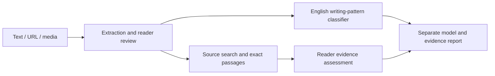
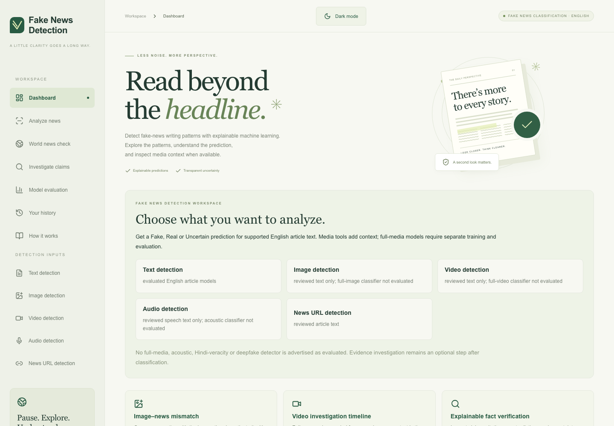
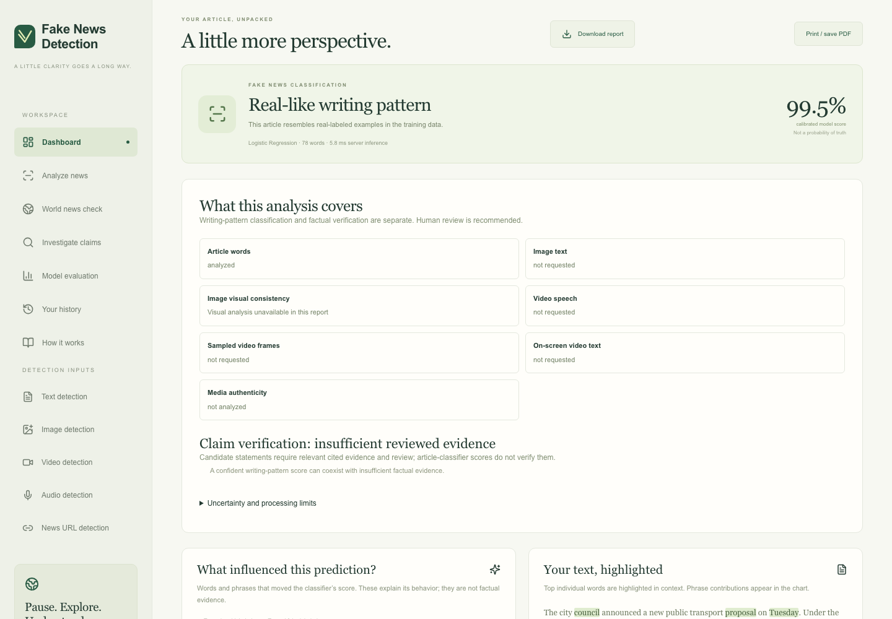
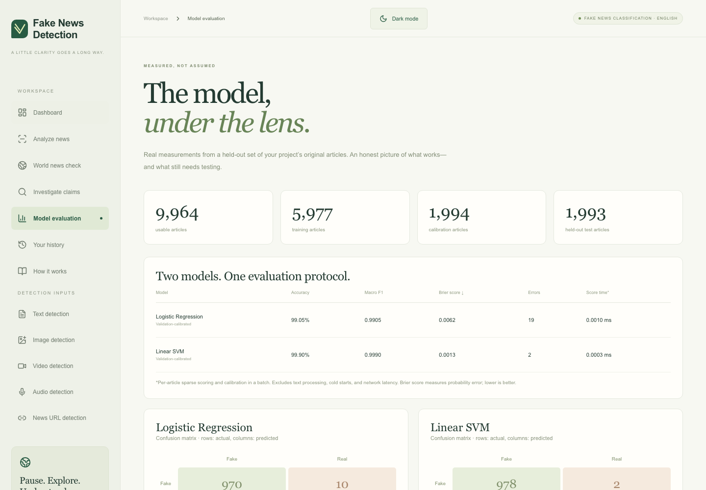

# Fake News Detection

[](https://nextjs.org/)
[](https://www.python.org/)
[](https://fastapi.tiangolo.com/)
[](https://fake-news-detection-priti.vercel.app/)

Fake News Detection helps you assess news using machine learning and understandable explanations.
Analyze English articles, review text extracted from media, and see which words influenced the prediction.

**Project Owner & Primary Developer:** [Priti Kumari](https://github.com/Priti02707).

> A prediction identifies learned writing patterns. It does not independently verify factual truth.

## Live Demo

- **Website:** [Try Fake News Detection](https://fake-news-detection-priti.vercel.app/)
- **Repository:** [Priti02707/Fake-News-Detection](https://github.com/Priti02707/Fake-News-Detection)

## About the Project

Misleading news can spread quickly and make reliable information harder to identify.
Fake News Detection helps readers examine articles using models trained on fake-labeled and real-labeled news.
It explains the words and phrases that influenced each prediction.
Readers can also extract text from images, audio, and videos before analyzing it.
The project encourages careful review and returns an uncertain result when the available text is unsuitable for a confident classification.

## Development status and master plan

The supplied master prompt is tracked in [MASTER_REQUIREMENTS.md](docs/MASTER_REQUIREMENTS.md), with the requested **Fake News Detection** identity and the existing repository. This update completes **Phase 0: reference research, architecture and project planning**, plus the requested rename. Later phase completion is not claimed.

- [Reference source comparison](docs/REFERENCE_COMPARISON.md), [implementation plan](PLAN.md), [phase acceptance gates](PHASES.md), [roadmap](ROADMAP.md), and [orchestrator](MASTER_ORCHESTRATOR.md).
- [Architecture](docs/ARCHITECTURE.md), [API contract](docs/API_CONTRACT.md), [evaluation register](docs/MODEL_EVALUATION.md), and [Phase 0 verification report](docs/PHASE_0_REPORT.md).

| Capability | Status |
| --- | --- |
| English article classifier, explanations, uncertainty, URL extraction | Implemented |
| OCR, short audio/video transcription, sampled frames, evidence notebook and browser history | Implemented; browser model downloads and codec support required |
| World-news discovery / published fact-check search | Implemented; provider availability / server API key required |
| CLIP, NLI wording assistance, Hindi extraction, Content Credentials inspection | Experimental; no forensic or factual verdict implied |
| Grounded automatic factual verdicts, Hindi veracity classifier, full-media/deepfake classifier | Unavailable pending configuration, artifacts and independent evaluation |
| Authenticated durable history, long-video server jobs, new design system/pages | Planned in sequential phases |



## Key Features

- **Text Fake News Detection:** Analyze English articles using Logistic Regression or calibrated Linear SVM.
- **Image Text Extraction and Analysis:** Read screenshot/photo text with OCR, correct it, and classify the reviewed words.
- **Video Speech Extraction and Analysis:** Transcribe short clips, inspect sampled frame text, and follow timestamps.
- **News URL Analysis:** Extract a public article and review its text before analysis.
- **World News Check:** Search international news and published fact-checks together, with language, publisher-country, and recent-news date filters. Review publisher ratings and open sources in the evidence notebook.
- **Fake/Real Prediction:** Receive a fake-like or real-like writing-pattern result, or **Uncertain** when appropriate.
- **Explainable Prediction Results:** Inspect influential words, phrase contributions, and reasons for uncertainty.
- **Model Performance Dashboard:** View recorded accuracy, dataset splits, and confusion matrices.
- **Audio Transcription:** Review speech from short audio files before classifying the spoken words.
- **Drag and Drop:** Add text, article links, images, audio, or video through the matching input tab.
- **Reports and History:** Download JSON reports, print/save PDF, and optionally keep up to 30 analyses in your browser.
- **Accessible Interface:** Responsive layouts, keyboard controls, previews, progress feedback, and light/dark themes.

**Optional and experimental:** image–description comparison with CLIP, semantic evidence comparison,
Content Credentials inspection, and Hindi extraction. These do not establish media authenticity or factual truth.
Evidence notebooks support source review; Google Fact Check search requires a configured API key.
See [capabilities and limitations](docs/USER_GUIDE.md).

## Technologies Used

| Area | Technologies used |
| --- | --- |
| Frontend | Next.js, React, TypeScript, Tailwind CSS, Lucide icons |
| Backend | Python, FastAPI, Pydantic, HTTPX |
| Machine Learning | Logistic Regression, Linear SVM; scikit-learn for training/evaluation, exported parameters for production |
| NLP | TF-IDF word/phrase features, language checks, optional Transformers.js evidence tools |
| Image Processing | Tesseract.js OCR; optional CLIP image–description comparison |
| Video Processing | Browser media APIs, Whisper through Transformers.js, sampled frames and OCR |
| Deployment | Vercel for Next.js and the lightweight FastAPI API; GitHub Actions for checks |

## How It Works

1. **Provide news content:** Paste text, enter a URL, or choose an image, audio file, or video.
2. **Process the input:** The app extracts article text, reads image text, or transcribes speech for your review.
3. **Analyze the text:** TF-IDF represents words and phrases, and the selected machine learning model scores them.
4. **Predict a class:** The app returns **Fake**, **Real**, or **Uncertain**, shown with writing-pattern labels and confidence where available.
5. **Explain the result:** Review influential terms, uncertainty notes, and a downloadable report.

Image and video predictions currently depend on reviewed extracted text.
They are **not** outputs from an independently evaluated visual or full-video fake-news classifier.
The report keeps full-media uncertainty separate from the text prediction.

## Project Screenshots

Real screenshots captured from the renamed application running as a local production build.
The public application is at [Fake News Detection](https://fake-news-detection-priti.vercel.app/).
Capture details are recorded in [docs/screenshots/README.md](docs/screenshots/README.md).

**Dashboard and input options**



<details>
<summary>View text analysis and model performance</summary>

**Text analysis result** — the built-in illustrative example, not a verified news report.
The displayed score describes the model's prediction, not factual truth.



**Recorded model performance**



</details>

**Project owner and developer**


## Installation

Prerequisites: **Node.js 22 or newer**, **npm**, and **Python 3.12**.
The trained text-model parameters are included; no training or API key is needed for basic analysis.

Clone the repository and install the dependencies:

```sh
git clone https://github.com/Priti02707/Fake-News-Detection.git
cd Fake-News-Detection
npm ci
python3.12 -m venv .venv
.venv/bin/python -m pip install -r requirements.txt
```

Start the backend in the first terminal, from the repository root:

```sh
.venv/bin/python -m uvicorn backend.main:app --reload --port 8000
```

Start the frontend in a second terminal, also from the repository root:

```sh
npm run dev
```

Open **http://localhost:3000**. Interactive API documentation is at **http://localhost:8000/api/docs**.
On Windows, use `py -3.12 -m venv .venv` and `.venv\Scripts\python.exe` instead of the Unix Python paths.

Media recognition downloads models on first use and needs internet access, browser codec support,
and sufficient device memory. Your raw media stays in the browser; reviewed text is sent for requested analysis.

See [setup, testing, and deployment](docs/DEPLOYMENT.md) for optional services and additional checks.

## How to Use

- **World news:** Open **World news check**, enter a claim or topic, choose source language, publisher country and news date window, then select **Check world news**. Worldwide/all languages searches across indexed sources; it does not translate queries or guarantee every country or story is covered. Use **Review this source** to inspect evidence. Country and date filters apply to GDELT news only; published fact-checks use the selected language across countries and dates. The classifier remains English-only, and search results do not automatically establish truth or falsehood.
- **Text:** Select **Paste text**, type/paste an article or drop a `.txt`/`.md` file, choose a model, and select **Analyze article**.
- **Image:** Select **Image**, upload/drop a readable screenshot, select **Extract image text**, and correct recognition errors.
- **Video:** Select **Video**, upload/drop a short clip, select **Transcribe video**, and review the transcript. Use **Inspect video frames** for on-screen text.
- **Audio:** Select **Audio**, upload/drop a short speech recording, select **Transcribe audio**, and review the words.
- **News URL:** Select **Article URL**, enter/drop a public article link, select **Extract**, review the text, and select **Analyze article**.

After media extraction, select **Classify reviewed words** to analyze in place,
or **Use reviewed text** to move the words to the article editor.
Dropping content does not automatically analyze it. Some publishers block article extraction.

Images support PNG/JPEG/WebP up to **10 MB** and **20 megapixels**.
Video supports MP4/WebM/MOV up to **25 MB / 60 seconds**; audio supports common formats up to **20 MB / 60 seconds**.
Text is limited to **20,000 characters**. See the [user guide](docs/USER_GUIDE.md) for formats and troubleshooting.

World news discovery uses GDELT without an API key. Published reviews require
`GOOGLE_FACT_CHECK_API_KEY` in the backend environment; see [.env.example](.env.example).
Missing configuration, provider outages and empty results appear separately, and an unavailable
provider does not discard the other provider's results. The combined endpoint is
`POST /api/world-news` with `query`, `language` (default `all`), `country` (default `all`),
and `timespan` (`1d`, `7d`, `1month`, or `3months`). Provider contracts:
[GDELT DOC API](https://blog.gdeltproject.org/gdelt-doc-2-0-api-debuts/) and
[Google claims search](https://developers.google.com/fact-check/tools/api/reference/rest/v1alpha1/claims/search).

## Model Performance

Recorded results on **1,993 held-out English articles**:

| Model | Accuracy | Macro-F1 | Test errors |
| --- | ---: | ---: | ---: |
| Logistic Regression | **99.05%** | 0.9905 | 19 |
| Linear SVM | **99.90%** | 0.9990 | 2 |

The experiment used **9,964 usable articles**: 5,977 training, 1,994 calibration, and 1,993 test examples.
Normalized duplicates were removed, and matching normalized headline groups stayed in one partition.

**Historical dataset accuracy does not guarantee accuracy on new real-world news.**
Source/style cues and remaining similar articles can inflate these scores.
They do not measure OCR, speech recognition, Hindi classification, or full-media detection accuracy.

Sources: [recorded metrics](models/metrics.json), [model card](MODEL_CARD.md), and [evaluation details](docs/EVALUATION.md).

## Project Structure

```text
app/          Next.js route entry, layout, and icon
frontend/     Interface, styles, upload controls, and browser workers
backend/      FastAPI routes, text inference, retrieval, and validation
api/          Vercel Python entry point
models/       Exported model parameters and evaluation metadata
scripts/      Data preparation, training, and evaluation commands
tests/        API, logic, and browser tests
docs/         User guide, architecture, research notes, and screenshots
reports/      Recorded research experiments and dataset audits
```

Technical references: [architecture](docs/ARCHITECTURE.md), [models](docs/MODELS.md),
[datasets](docs/DATASETS.md), [security](docs/SECURITY.md), and [implementation status](docs/IMPLEMENTATION_STATUS.md).

## Future Improvements

- Evaluate advanced text models such as DistilBERT, RoBERTa, and DeBERTa on independent publishers and newer news.
- Train and independently evaluate image–text fake-news classifiers.
- Extend video analysis with evaluated visual/temporal models and background processing for longer clips.
- Evaluate combined acoustic and spoken-content models for audio.
- Develop reliable Hindi and mixed-language classification beyond experimental extraction.
- Add separately evaluated deepfake detection, keeping media manipulation distinct from news classification.
- Validate learned multimodal fusion on suitable licensed datasets before production use.

Research training pipelines and small transformer pilots exist, but they have not been promoted to production.
No validated deepfake detector or full-media accuracy is claimed.

## Author

**Priti Kumari — Project Owner & Primary Developer** — [@Priti02707](https://github.com/Priti02707)

## License

No software license has been selected by the repository owner. No LICENSE is added automatically. External code, models and datasets retain their own terms and attribution. Reference repositories were reviewed without copying their code; see the [reuse review](docs/REFERENCE_COMPARISON.md).

Development is AI-assisted. Git history preserves actual commit authorship; third-party work and historical benchmark results are not presented as newly authored or newly executed experiments.
