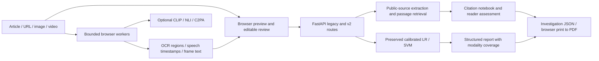

# Architecture

Next.js retains the established interface and browser-local media privacy model. Heavy recognition models are lazy, pinned downloads in workers, not Vercel Python dependencies. API startup never downloads transformer checkpoints. Files remain on the device; reviewed words and bounded observation metadata go to FastAPI only for requested analysis.

`backend/inference.py` owns production scoring; `investigation.py` owns candidate selection and passage ranking; `fusion.py` owns explicit rule-based coverage/uncertainty; `schemas.py` defines request contracts; `v2.py` assembles versioned routes. Registry metadata is read without importing PyTorch. Local research inference lives in `backend/challenger.py` and is not imported by the API.

Browser media workers are asynchronous jobs with cancellation, bounded file/duration/frame limits, and processing timeouts. A server job broker is not introduced for the current 60-second browser workflow. There is no persistent `/jobs` service advertised; `/api/v2/capabilities` reports this explicitly. A future server GPU/media service would require a real broker and storage rather than pretending Vercel instance memory is durable job storage.

API v2 image/video routes accept reviewed extraction metadata, not raw media uploads. The server labels the observation origin as client-submitted and does not authenticate those observations. The legacy `/api/analyze`, `/extract`, `/fact-check`, `/metrics`, and `/health` contracts remain available. See `MULTIMODAL_PIPELINES.md` for execution details.
