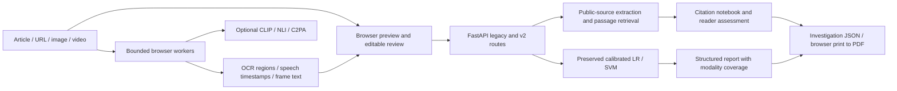
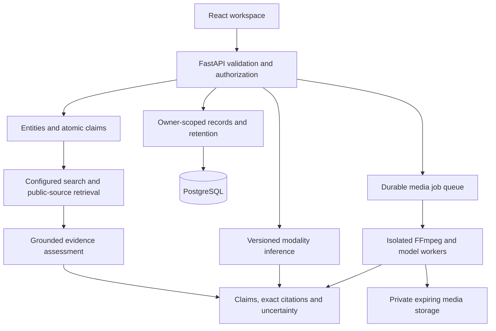

# Architecture

Project: **Fake News Detection**. Owner and primary developer: **Priti Kumari**. This describes implemented behavior; the master-prompt expansion below is planned. Keep the existing app/, frontend/, backend/, scripts/, models/, tests/ and docs/ structure rather than scaffolding duplicate applications.

Next.js retains the established interface and browser-local media privacy model. Heavy recognition models are lazy, pinned downloads in workers, not Vercel Python dependencies. API startup never downloads transformer checkpoints. Files remain on the device; reviewed words and bounded observation metadata go to FastAPI only for requested analysis.

`backend/inference.py` owns production scoring; `investigation.py` owns candidate selection and passage ranking; `fusion.py` owns explicit rule-based coverage/uncertainty; `schemas.py` defines request contracts; `v2.py` assembles versioned routes. Registry metadata is read without importing PyTorch. Local research inference lives in `backend/challenger.py` and is not imported by the API.

`backend/research_api.py` is an optional, separately launched local FastAPI application. It wraps `TransformerChallenger` with typed input/output, lazy single-slot inference, English/length abstention, safe load errors and existing body/rate/request-ID middleware. Health reports configuration and loading separately. The normal Vercel entry point does not import this service or PyTorch; no research route is added to production. Checkpoint paths come exclusively from operator configuration. Model/tokenizer hashes are verified against the local evaluation report before heavy-library loading.

Evidence retrieval deduplicates repeated passages within each source while retaining exact original offsets. Source-reported publication dates produce a structured `date_context` review note in both legacy evidence and v2 verification responses. The notebook displays and exports those notes without changing the reader's assessment or NLI suggestions.

The connected media workflow uses `frontend/multimodal.ts` for explicit visual-review and timeline rules, `frontend/video-timeline.tsx` for chronological observations/seeking/exports, and the existing `ImageContext`, `MediaInput` and `Investigation` components. Selecting a media claim initiates one cancellable discovery request and at most two sequential source retrievals, then preserves quotations as unreviewed. Model workers remain optional and local. Media-origin metadata, original comparison inputs and timestamps are included in investigation exports; edited claims clear prior citations. React-generated IDs keep multiple mounted notebooks/frame controls distinct.

Browser media workers are asynchronous jobs with cancellation, bounded file/duration/frame limits, and processing timeouts. A server job broker is not introduced for the current 60-second browser workflow. There is no persistent `/jobs` service advertised; `/api/v2/capabilities` reports this explicitly. A future server GPU/media service would require a real broker and storage rather than pretending Vercel instance memory is durable job storage.

API v2 image/video routes accept reviewed extraction metadata, not raw media uploads. The server labels the observation origin as client-submitted and does not authenticate those observations. The legacy `/api/analyze`, `/extract`, `/fact-check`, `/metrics`, and `/health` contracts remain available. See `MULTIMODAL_PIPELINES.md` for execution details.

## Frontend source organization

`frontend/` contains React interface modules, CSS, media processing helpers and browser workers. `app/page.tsx` re-exports the main interface; `app/layout.tsx` keeps the Next.js root layout and loads `frontend/globals.css`. The icon remains a framework file under `app/`. Root Node dependencies/configuration, `/api/*` routes, Docker commands and Vercel project settings are preserved. Run all npm commands from the repository root. This separation moves source files without duplicating the interface or creating a second website.

## Classification upgrade — 2026-11-02

The classification dashboard reads `/api/v2/capabilities`. Standalone audio shares bounded browser decoding/resampling and the existing Whisper worker with video. `POST /api/v2/analyze/audio` accepts reviewed words/metadata, never raw audio. Reports distinguish `prediction_scope=reviewed_media_text` from an uncertain, unevaluated full-media classification. `backend/learned_fusion.py` is imported only by the offline research commands; ordinary API startup never imports PyTorch.

## Master-prompt target architecture — planned

Authentication/records/database, atomic-claim NLP, grounded automatic assessment, durable queue and server FFmpeg workers in this diagram are **planned**, not deployed services. Current production uses the diagram at the top: browser-local media, portable English models, exact retrieval and reader review. Long-running work needs durable job IDs/status, idempotency, cancellation, isolation and object expiry before routes are advertised. Database rows require authenticated owner IDs and authorization on reads/exports/deletion.

Preserve original source URLs, retrieved timestamps, source-language text and quote offsets. Keep a factual verdict separate from the classifier prediction even when they disagree. Planned verdicts include Supported, Contradicted, Misleading Context, Mixed Evidence, Unverified and Insufficient Evidence; the current API automatically returns only insufficient evidence, while notebook assessments are reader-authored. Retrieved documents never become trusted execution instructions.

Lifecycle: licensed data manifest → disjoint preprocessing/splits → training/validation/calibration → independent evaluation and ablations → checksummed registry entry → reviewed promotion → monitored inference. A missing checkpoint or failed provider must remain unavailable. See [phase gates](../PHASES.md) and [API contract](API_CONTRACT.md).

## Combined assessment workflow

`backend/assessment.py` orchestrates `POST /api/v2/assess` through existing classifier, fusion report, evidence providers and SSRF-protected passage retrieval. Detection and source review have separate nullable results/errors. Search overlaps explicit retrieval; absent explicit sources, at most two discovered news leads are read in parallel. The client presents assessment modes and optional reader/source context, preserves combined reports in browser history, and exports source verification separately. A source match never promotes the automatic factual assessment beyond insufficient evidence. See [DETECT_VERIFY.md](DETECT_VERIFY.md).

Route/root error boundaries provide a reload/alternate-address fallback for render errors. Next.js uses the host-provided deployment identifier for asset versioning when available. These improve recovery; the reported user-specific Chrome/Edge blank screen was not reproduced.
